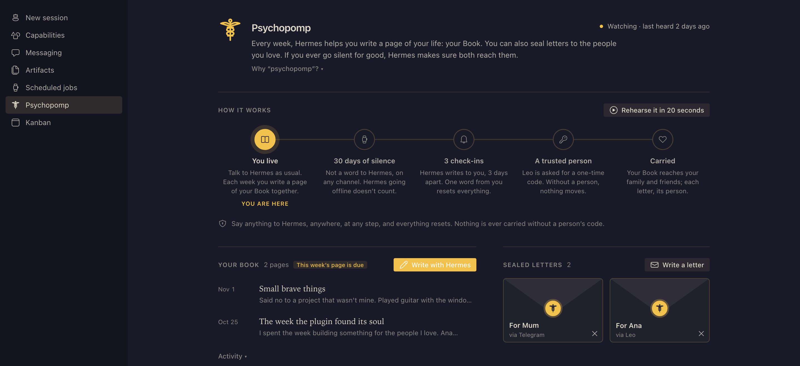
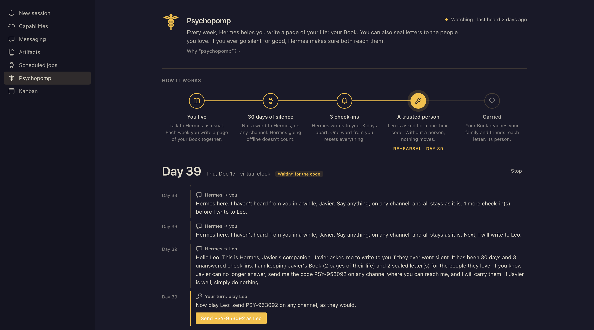
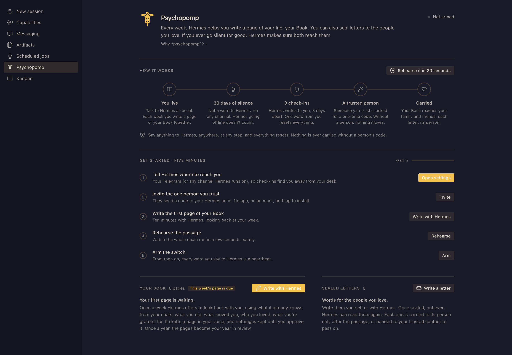

# ☤ Psychopomp

**Every week, your Hermes helps you write a page of your life. If you ever go silent for good, it carries your words to the people you love.**



Psychopomp is a Hermes Agent plugin with a Desktop page. It does three things:

1. **Your Book.** Once a week, Hermes offers to look back at your week with you. It already knows your conversations and its memory of you, so it drafts a short page in your voice: what you did, what moved you, who you loved, what you're grateful for, one line for the people who love you, and one intention for next week. Nothing is kept until you approve it. Once a year, the pages become **your year in review**.
2. **Sealed letters.** You write letters to the people you love, alone or with Hermes. Once a letter is sealed, not even Hermes can read it again.
3. **The passage.** If you stop talking to Hermes for a long time and don't answer its check-ins, it asks the one person you trust for a code. Only when that person sends it does Hermes hand them your Book, to share with family and friends, and carry each letter to its recipient.

Most of the value is in the weekly Book, which is useful from week one. The passage is what makes the Book matter.

## Why "psychopomp"?

In Greek myth, Hermes had two jobs. He was the **messenger** of the gods, and he was the **psychopomp** (*psychopompós*, "guide of souls"): the companion who walked beside every person to the threshold, so nobody made that journey alone. Your Hermes already carries your messages. This plugin gives it the second, gentler job: keeping your story while you live it, and carrying your words when you no longer can.

The tone is vitalist and warm, never morbid. Faith, hope, love, gratitude and forgiveness lead, with the Greek virtues of courage and measure beneath them.

## How the passage works

```
you talk to Hermes ─► heartbeat (CLI, Desktop, TUI, Telegram, any gateway channel)

30 days of silence ─► check-in ─► check-in ─► check-in   (3 days apart, on your channels)
                                                  │ no answer
                                                  ▼
             your trusted person is asked for a one-time code (PSY-123456), with gentle reminders
                                                  │
        they send it on ANY channel Hermes listens to ─► the Book goes to them,
                                                          each letter to its recipient
        you say anything, anywhere ─► everything resets, and they're told you're fine
```

- **Never early.** Nothing is carried unless all three hold: the silence, every unanswered check-in, *and* a person sending the code. A timer alone can't do it.
- **Any channel.** The code works on any gateway channel, even from someone who isn't on your Hermes allow-list. It's caught before the gateway checks the sender and never reaches the model.
- **Hermes's downtime doesn't count as your silence.** If Hermes itself was offline, that time is added back.
- **Delivery that recovers.** Each letter goes to its own channel. If that fails, or the recipient has no channel, your trusted person gets the letter to pass on. Failed sends are retried.
- **Guessing doesn't work.** Codes have six digits. Five wrong tries retire the code and send your trusted person a new one.

## See it work in 20 seconds: the rehearsal

A dead man's switch normally waits a month before doing anything, so you can't watch it work, and you have no reason to trust it. The rehearsal fixes that.



Click **Rehearse it in 20 seconds**. Psychopomp deep-copies your real setup and runs the **same switch code** (`tick()` in `psychopomp_core.py`) on a **virtual clock**. Each step passes a virtual timestamp (`started + day × 86400`), so the real code sees 30 days of silence, three check-ins three days apart, and the code request on day 39. Quiet days go by in a fraction of a second, and days with messages pause so you can read them. Every message Hermes *would* send appears on the page, addressed to whoever would receive it.

On day 39 you play your trusted person and send the code. The page then shows your Book and each sealed letter being "carried". Nothing leaves your Hermes, no letter is opened, and your real switch doesn't move. You can also have each step sent to your own Telegram, or run the rehearsal from any chat with `/psychopomp rehearse`.

## Install

```bash
hermes plugins install ponzgpt/psychopomp
hermes plugins enable psychopomp
```

Or, in Hermes Desktop: **Capabilities › Plugins › Install from GitHub › `ponzgpt/psychopomp`**. The agent half installs into your Hermes, and the page installs into Desktop.

Open **Psychopomp** in the sidebar. A five-minute checklist walks you through setup:



1. **Tell Hermes where to reach you** (Settings › Plugins › Psychopomp), e.g. `telegram:123456789`.
2. **Invite the one person you trust.** They send a `PSY-JOIN-…` code to your Hermes once, and Hermes learns how to reach them. They need no app and no account.
3. **Write the first page of your Book** with Hermes.
4. **Rehearse the passage.**
5. **Arm the switch.**

From chat: `/psychopomp status | invite | rehearse | arm | doctor | test`.

**Run it on a Hermes that never sleeps**, such as Hermes Cloud, a home server or a VPS. A laptop that sleeps can't keep watch, and `doctor` warns you about it.

## Hermes surfaces it uses

| Surface | What for |
|---|---|
| `pre_llm_call` hook | Heartbeat on every surface (Hermes's own cron jobs don't count), and the weekly invitation to write a page, added as context to a conversation you're already having (no background LLM calls) |
| `pre_gateway_dispatch` hook | Invitation and confirmation codes on any channel, caught before auth and answered there |
| Background ticker (one process at a time, file lock) | Advances the switch and the weekly nudge every 30 s |
| Tools `psychopomp_write_page`, `psychopomp_read_book`, `psychopomp_seal_letter`, `psychopomp_status` | Hermes writes pages and seals letters only after you approve; it sees envelopes, never sealed words |
| `/psychopomp` and `hermes psychopomp` | status, arm, invite, rehearse, doctor, test, reset |
| Desktop page (`desktop/plugin.js` + `dashboard/plugin_api.py`) | Built from the Desktop UI kit (`Button`, `Badge`, `Dialog`, `StatusDot`, `Loader`…) and theme tokens, so it follows any theme |
| `config_schema` | The settings form in Desktop |

## Disclosures (risky behaviour)

- **Sends messages on your behalf** to the channels you configure: weekly nudges and check-ins to you, a code request and reminders to your trusted person, and, only after their code, your Book and letters.
- **Reads every inbound gateway message** at ingress, looking for `PSY-…` codes. Messages that carry a code are consumed (not passed to the model). All other messages pass through untouched.
- **Stores your Book and letters in plain text** in `$HERMES_HOME/plugin-data/psychopomp/` on the machine running Hermes.
- **Imports `tools.send_message_tool`** (what `hermes send` uses), because Hermes has no public send API for plugins yet. Letters addressed by email use Hermes's `EMAIL_*` SMTP settings when they're present.

## Develop

```bash
./scripts/check.sh   # invariant tests + syntax + Hermes's own plugin validator
ln -s "$PWD" ~/.hermes/plugins/psychopomp && hermes plugins enable psychopomp
```

`psychopomp_core.py` holds all the logic as pure functions (Book, letters, switch, rehearsal) and is tested without Hermes. `psychopomp_store.py` does the I/O, and `__init__.py` connects it to Hermes. The tests pin the promises above: nothing is ever delivered without the code, sealed words never appear in any view or log, and a rehearsal sends nothing and leaves the real switch alone.

MIT © Javier Ponz. Written with AI agents; specified and tested by a human.
